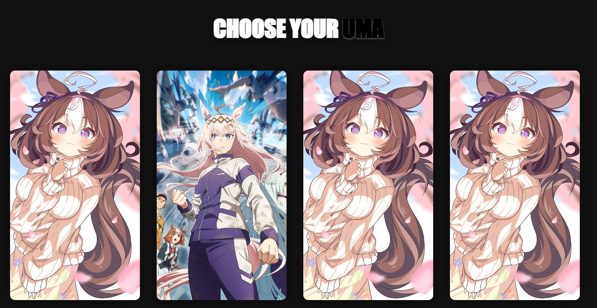
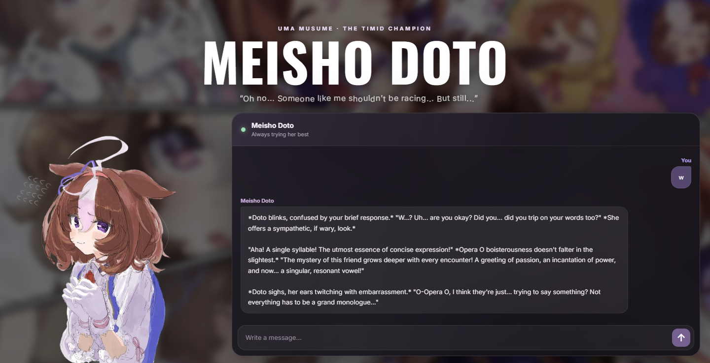
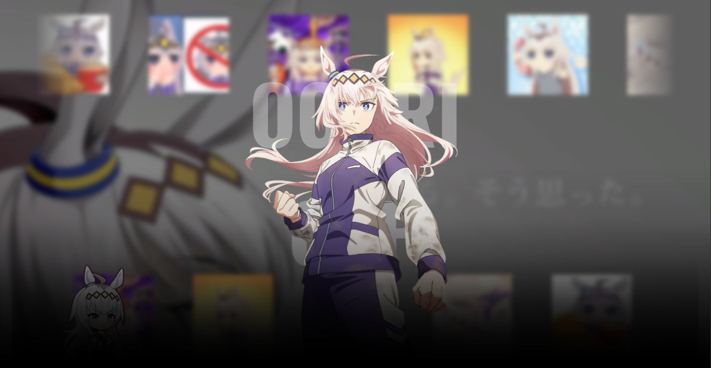
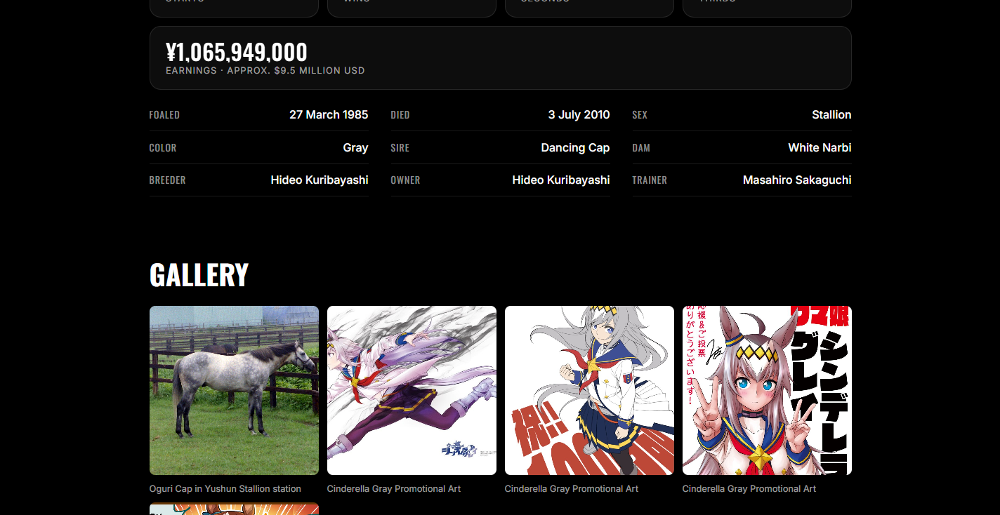
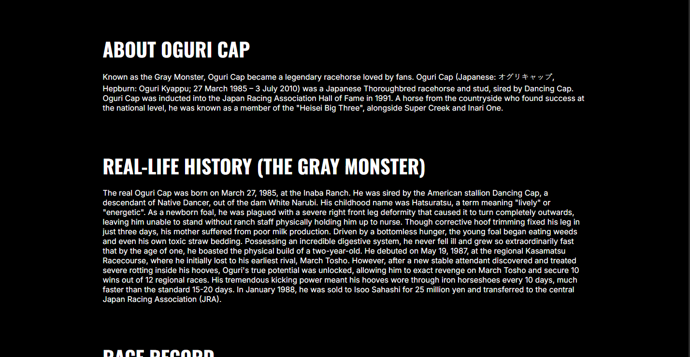

# Umachat 
UmaChat World started as a Character.AI-inspired project and grew into a small website dedicated to different Uma Musume characters. Each Uma has her own page, personality, and unique content.

The project is still a work in progress, but 2 character pages are available so far!

## What does the card do?
Simple, when u open a card you will get redirected to a page containing some stuff and designed with the uma

Meisho doto: a simple page with a chatbot!
Oguri cap: contains info, bio, career and a gallery with react!!


## you want to run it locally?
fork this project, follow the instructions on how to get your token for character ai [here](https://github.com/Skidy89/node_characterai-2.0#using-an-access-token)
make sure to set up your .env file with the provided token.
then you use 
```bash
npm run build && npm run dev
```
and thats all!

## screenshoots
<p align="center">
  
  
  
  
  
</p>
